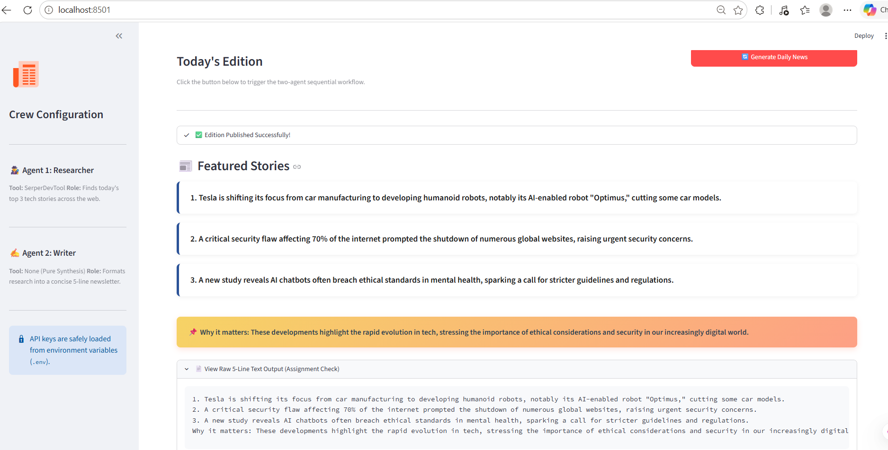
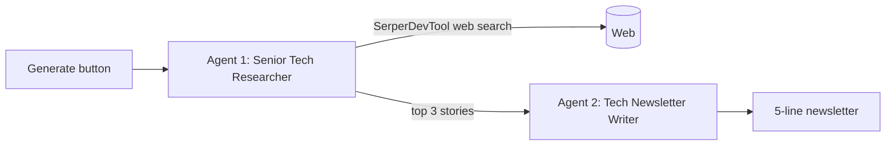

# TechPulse: Two-Agent Crew for a Tech Newsletter

> Two AI agents work in sequence: one researches today's top tech news, the other writes a 5-line newsletter.

    

## Overview

A small but complete **multi-agent** example with [CrewAI](https://www.crewai.com/). A *Senior Tech Researcher* agent searches the live web with Serper, then a *Tech Newsletter Writer* agent turns the findings into a strict 5-line newsletter. A Streamlit page triggers the crew and shows the result.

## Features

- **Researcher agent** with `SerperDevTool` for live web search
- **Writer agent** that formats exactly 5 lines
- Sequential process: research output feeds the writing task
- Streamlit news-portal UI with live status
- API keys loaded from `.env`, checked before running

## Demo



## How it works



## Tech stack

| Layer | Technology |
|---|---|
| Agents | CrewAI (sequential process) |
| Tools | crewai-tools `SerperDevTool` |
| LLM | OpenAI |
| UI | Streamlit |

## Project structure

```text
.
├── newsletter.py
├── requirements.txt
├── .env.example
└── newsletter.png
```

## Getting started

**Prerequisites:** Python 3.10+, a free [Serper](https://serper.dev) API key

```bash
git clone https://github.com/prasanth-sundararajan/Two-Agent-Crew-for-a-Tech-Newsletter.git
cd Two-Agent-Crew-for-a-Tech-Newsletter
python -m venv .venv
# Windows: .venv\Scripts\activate    macOS/Linux: source .venv/bin/activate
pip install -r requirements.txt
```

Copy `.env.example` to `.env` and add your keys:

```bash
cp .env.example .env
```

## Usage

```bash
streamlit run newsletter.py
```
Click **Generate Daily News**.

## Configuration

| Variable | Required | Description |
|---|---|---|
| `OPENAI_API_KEY` | Yes | OpenAI API key used for chat and embeddings |
| `SERPER_API_KEY` | Yes | Serper.dev key for Google search |

## License

Released under the [MIT License](LICENSE).

## Author

**Prasanth Sundararajan**, Senior SRE and AI Engineer  
[LinkedIn](https://www.linkedin.com/in/prasanth-s-a093a7109/) · [GitHub](https://github.com/prasanth-sundararajan)
